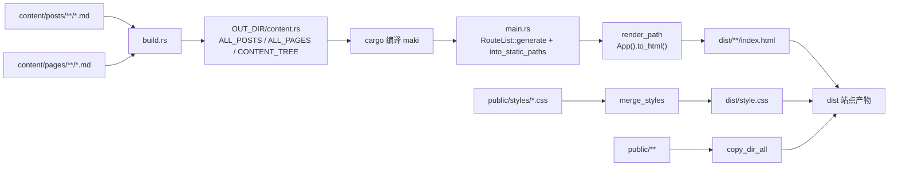

# 架构与构建流程

## 总览

Maki 没有使用 `cargo-leptos`，而是把 Leptos 当作模板/组件库：`build.rs` 在编译前把 Markdown 变成 Rust 常量，`src/main.rs` 在运行时枚举路由并调用 `App().to_html()`，最终写出静态文件。



关键点：

- 内容是**编译期输入**，修改内容后需要重新运行 `cargo run`；生成阶段不做运行时文件读取。
- 页面是**预渲染的静态 HTML**，浏览器端没有 Leptos hydration，也没有客户端路由。
- 所有站内绝对链接都必须带 `base` 前缀；这一层由 `src/base.rs` 和 `Link` 组件负责。

## 构建期：`build.rs`

### 1. 定位内容目录

`build.rs` 读取 `MAKI_CONTENT_DIR`：

| 情况 | 行为 |
| --- | --- |
| 未设置或为空 | 使用 `CARGO_MANIFEST_DIR/content` |
| 相对路径 | 相对 `CARGO_MANIFEST_DIR` 解析，而不是相对当前 shell 目录 |
| 绝对路径 | 直接使用 |
| 显式设置但不是目录 | 构建失败：`MAKI_CONTENT_DIR is not a directory` |

无论使用哪个目录，都期望其中存在 `posts/` 和/或 `pages/`；目录缺失时按空集合处理。

### 2. 扫描文章

`scan_posts()` 递归遍历 `posts/` 下的所有 `.md` 文件：

- `slug` = 相对 `posts/` 的路径去掉扩展名，分隔符统一为 `/`。例如 `posts/rust/memory-layout.md` 的 slug 是 `rust/memory-layout`。
- `full_path` = `/posts/{slug}`，这是站点内的文章 URL。
- 使用 `yaml_front_matter` 解析 frontmatter，`title` 必填；解析失败会 panic。
- `date` 可选，按 `NaiveDate` 解析；缺失时取文件修改时间的 UTC 日期；解析失败时回退到 `1970-01-01`。
- `tags` 默认空数组。
- `summary` 可选；缺失时从渲染后的 HTML 中剥离标签，取纯文本前 200 **字节**。
- 文章按 `date` 降序排序；同日期文章的相对顺序取决于文件扫描顺序，未做额外排序。

### 3. 扫描独立页面

`scan_pages()` 递归遍历 `pages/` 下的所有 `.md` 文件：

- `slug` = 相对 `pages/` 的路径去掉扩展名，分隔符统一为 `/`。
- 如果 frontmatter 能成功解析，使用其中的 `title`，正文使用 frontmatter 之后的内容。
- 如果 frontmatter 解析失败，取正文第一行 `# ` 后面的文本作为标题，并把**整个文件**作为 Markdown 正文；仍取不到标题时使用 `"关于"`。
- 页面没有日期、标签和摘要字段。

### 4. Markdown 渲染

`markdown_to_html()` 使用 `pulldown-cmark` 的默认 CommonMark 选项，并单独接管围栏代码块：

1. 遍历 `pulldown-cmark` 事件。
2. 遇到 `CodeBlock` 时收集代码文本；遇到结束事件时：
   - 有语言标记：用 `syntect` 的默认语法集按 token 查找语法，未知语言回退到纯文本语法，输出带 class 的 `<span>`，使用 `ClassStyle::Spaced`。
   - 无语言标记（包括缩进代码块）：HTML 转义后输出 `<pre class="code-block"><code>…</code></pre>`。
3. 其余事件交给 `pulldown_cmark::html::push_html` 生成 HTML。

生成的代码块统一包在 `<pre class="code-block"><code>…</code></pre>` 中；高亮配色由 `public/styles/syntax.css` 按 class 映射。

### 5. 构建归档树

`build_content_tree()` 按文章 slug 的路径分段构造目录树：

- 根节点名为 `posts`，`path` 为 `/archive`，不直接渲染。
- 中间路径段生成目录节点，`is_post = false`。
- 最后一段生成文章叶子节点，`name` 使用文章标题，`path` 使用文章的 `full_path`。
- 排序规则：同一层目录节点排在文章节点之前；同类节点按 `name` 字典序排序；递归处理子目录。

注意：目录节点在页面上只显示为文件夹名称（`<span class="folder">`），不是链接；只有文章叶子节点是可点击链接。

### 6. 生成 `content.rs`

`generate_content_rs()` 把结果写入 `OUT_DIR/content.rs`，包含：

| 常量 | 类型 | 说明 |
| --- | --- | --- |
| `BASE_URL` | `&str` | 规范化后的 `MAKI_BASE_URL`，构建期常量 |
| `ALL_POSTS` | `&[Post]` | 全部文章，按日期降序 |
| `ALL_PAGES` | `&[StaticPage]` | 全部独立页面 |
| `CONTENT_TREE` | `&ContentNode` | 归档目录树 |

字符串会经过 Rust 字面量转义；HTML 直接作为字符串嵌入。`src/content.rs` 通过 `include!(concat!(env!("OUT_DIR"), "/content.rs"));` 引入这些常量。

`build.rs` 声明了以下重跑条件：

```text
cargo::rerun-if-env-changed=MAKI_CONTENT_DIR
cargo::rerun-if-env-changed=MAKI_BASE_URL
cargo::rerun-if-changed=<内容目录>
```

因此修改内容、切换内容目录或修改 `MAKI_BASE_URL` 后再次构建都会重新生成。

## 编译期数据模型

定义在 `src/models/post.rs`，由 `src/models/mod.rs` 重新导出：

```rust
pub struct Post {
    pub slug: &'static str,
    pub full_path: &'static str,
    pub title: &'static str,
    pub date: NaiveDate,
    pub tags: &'static [&'static str],
    pub summary: &'static str,
    pub content_html: &'static str,
}

pub struct StaticPage {
    pub slug: &'static str,
    pub title: &'static str,
    pub content_html: &'static str,
}

pub struct ContentNode {
    pub name: &'static str,
    pub path: &'static str,
    pub is_post: bool,
    pub children: &'static [ContentNode],
}
```

所有字段都是 `'static`，因为数据来自编译期生成的字面量。

## 生成期：`src/main.rs`

### 1. 清理并准备输出目录

`main()` 首先根据 `base_prefix()` 决定输出根目录：

- `base_prefix()` 为空：`dist/`
- 否则：`dist/<base 去掉前导斜杠>`，例如 `/maki` → `dist/maki`

如果 `dist/` 已存在，会**整个删除**（不只是当前 `base` 子目录），然后重新创建输出根目录。

### 2. 枚举静态路由

```rust
let routes = Owner::new().with(|| {
    provide_context(RequestUrl::new(base));
    RouteList::generate(App)
});
let raw_paths = futures::executor::block_on(routes.into_static_paths());
```

- `RouteList::generate` 收集 `App` 中所有 `SsrMode::Static` 路由。
- 带参数的路由通过 `prerender_params` 提供具体值：
  - `/tag/:tag`：全部文章标签去重后的集合（`BTreeSet`，天然有序）。
  - `/posts/*slug`：全部文章的 slug。
  - `/:slug`：全部独立页面的 slug。
- 路径经 `clean_path()` 折叠重复 `/`，再用 `HashSet` 去重、排序。

### 3. 逐路由渲染

`render_path(path)`：

1. 创建独立的 `Owner`。
2. 注入 `RequestUrl::new(path)`，让 `leptos_router` 按该 URL 匹配路由。
3. 调用 `App().to_html()`，得到完整的 `<html>…</html>` 文档。

输出路径计算：

```text
path 去掉 base 前缀 → 去掉首尾 / → 空则 index.html，否则 <relative>/index.html
```

例如：

| 路由 | 输出文件 |
| --- | --- |
| `/` | `dist/index.html` |
| `/archive` | `dist/archive/index.html` |
| `/tags` | `dist/tags/index.html` |
| `/tag/rust` | `dist/tag/rust/index.html` |
| `/posts/rust/memory-layout` | `dist/posts/rust/memory-layout/index.html` |
| `/about` | `dist/about/index.html` |

如果某个生成路径不以 `base` 开头，`main.rs` 会 panic，提示 `route path ... not prefixed by base ...`。

### 4. 合并样式

`merge_styles()` 按固定顺序拼接 `public/styles/` 下的文件，写入 `<out_root>/style.css`：

```text
variables.css
base.css
layout.css
navbar.css
post.css
markdown.css
syntax.css
archive.css
tags.css
footer.css
not-found.css
```

文件不存在时跳过；不做压缩或后处理。顺序影响层叠结果，新增样式文件必须同时登记到这个列表。

### 5. 复制公共资源

- `public/` 递归复制到输出根目录，保留目录结构。
- 名为 `styles` 的目录（任意层级）被排除，因为样式已经合并成 `style.css`。
- 根级文件 `.nojekyll`、`CNAME` 不参与普通复制，而是由 `copy_root_level_files()` 复制到 **`dist/` 根目录**。

### 6. 子路径重定向

当 `base` 非空时，`write_redirect_index()` 生成 `dist/index.html`，通过 canonical、meta refresh 和 `location.replace` 把访问 `/` 的请求引导到 `{base}/`。

注意：该文件位于 `dist/` 根，不在 `dist/<base>/` 内。它只在整体部署 `dist/` 时生效；如果部署工具只上传 `dist/<base>/`，这个跳转页不会被包含。

### 7. 生成 404

`write_not_found()` 用一个必定不匹配具体页面的 URL（`{base}/__nonexistent__`）走一遍 `render_path`，触发 `Routes` 的 `NotFound` fallback，然后写入 `<out_root>/404.html`。这样 404 页面也带有完整导航和样式。

## 路由表

下表是 `src/app.rs` 中声明的路由，路径均为站点相对路径；实际渲染时由 `Router base` 和 `RequestUrl` 自动加 `base` 前缀。

| 路径 | 组件 | 预渲染参数 | 说明 |
| --- | --- | --- | --- |
| `/` | `Home` | 无 | 首页，列出全部文章 |
| `/archive` | `Archive` | 无 | 归档目录树 |
| `/tags` | `Tags` | 无 | 标签云 |
| `/tag/:tag` | `TagPosts` | 全部文章标签 | 按标签筛选文章 |
| `/posts/*slug` | `PostDetail` | 全部文章 slug | 文章详情，slug 可包含 `/` |
| `/:slug` | `StaticPageView` | 全部页面 slug | 独立页面，仅匹配单段路径 |
| `/*` | `NotFound` | 无 | 兜底；同时手动生成 `404.html` |

路由优先级由 `leptos_router` 处理；`/archive`、`/tags` 等具体路径不会被 `/:slug` 捕获。新增顶层页面时仍建议显式声明路由，否则请求可能落入 `/:slug` 并显示“页面不存在”。

## 渲染层

### `App`

`src/app.rs` 的 `App` 渲染完整文档：

- `<html lang="zh-CN">`
- `<head>`：charset、viewport、主题初始化内联脚本、固定标题 `Maki`、`{base}/style.css`
- `<body>`：`Router` 包裹 `Navbar`、`main`、`Footer`
- `main` 中 `Routes` 使用 `NotFound` 作为 fallback

### 组件

| 组件 | 职责 |
| --- | --- |
| `Navbar` | 品牌链接、首页/文章目录/标签/关于导航、主题切换按钮与切换脚本 |
| `Footer` | 页脚，外链到 Maki 仓库 |
| `Link` | 站内链接组件；对以 `/` 开头的 href 调用 `full_href` 加 base 前缀 |
| `MarkdownHtml` | 用 `inner_html` 渲染预生成的 Markdown HTML |
| `ContentTree` | 递归渲染 `ContentNode`；目录显示为文件夹文本，文章显示为 `Link` |

### 页面

| 页面 | 行为 |
| --- | --- |
| `Home` | 遍历 `ALL_POSTS`，渲染标题、日期、标签链接和摘要 |
| `Archive` | 使用 `CONTENT_TREE` 渲染目录树 |
| `Tags` | 从 `ALL_POSTS` 收集标签，`BTreeSet` 去重并排序，渲染标签云 |
| `TagPosts` | 读取 `tag` 路由参数，筛选 `post.tags` 中包含该标签的文章；标题为 `标签: <tag>` |
| `PostDetail` | 读取 `slug` 参数，在 `ALL_POSTS` 中查找；找不到时显示“文章不存在。” |
| `StaticPageView` | 读取 `slug` 参数，在 `ALL_PAGES` 中查找；找不到时显示“页面不存在。” |
| `NotFound` | 显示 404、返回首页链接 |

所有页面都通过 `Link` 生成站内绝对链接，因此子路径部署时导航和文章链接会自动带 base 前缀。

## 主题机制

主题切换由两段内联 JavaScript 完成，不依赖 Leptos 客户端运行时。

### 首屏防闪烁

`src/app.rs` 的 `THEME_INIT_SCRIPT` 在 `<head>` 中同步执行：

1. 读取 `localStorage` 的 `maki-theme`。
2. 值不是 `light`/`dark` 时，使用 `matchMedia('(prefers-color-scheme: dark)')` 决定。
3. 把结果写入 `document.documentElement` 的 `data-theme` 属性。
4. 初始化时如果 `localStorage` 中没有有效选择，则监听系统主题变化并实时更新。

样式表通过 `:root[data-theme="dark"]` 覆盖 CSS 变量，因此首屏不会先渲染浅色再切换。

### 手动切换

`src/components/navbar.rs` 的 `THEME_TOGGLE_SCRIPT` 监听 `#theme-toggle` 点击：

- 在 `light`/`dark` 之间翻转。
- 写入 `data-theme` 和 `localStorage`。
- 支持 View Transitions API 时，临时给 `<html>` 加 `theme-transition` 并调用 `startViewTransition`，过渡结束后移除；不支持时用 CSS 过渡并在 350ms 后移除类名。

## 设计约束

- **编译期内容**：所有内容和生成结果都在 `build.rs` 中完成，运行时没有文件系统访问。
- **静态多页**：链接是普通 `<a>`，整页导航；没有 SPA 路由。
- **base 前缀**：站内绝对链接必须经过 `full_href` 或 `Link`；Markdown 正文中的绝对链接不会被自动改写。
- **路由可枚举**：新增页面必须使用 `SsrMode::Static`，并提供 `prerender_params`（如果路径含参数），否则不会被 `RouteList::generate` 输出。
- **`dist/` 全量重建**：每次运行都会删除 `dist/`，不要把它当作持久化目录。
